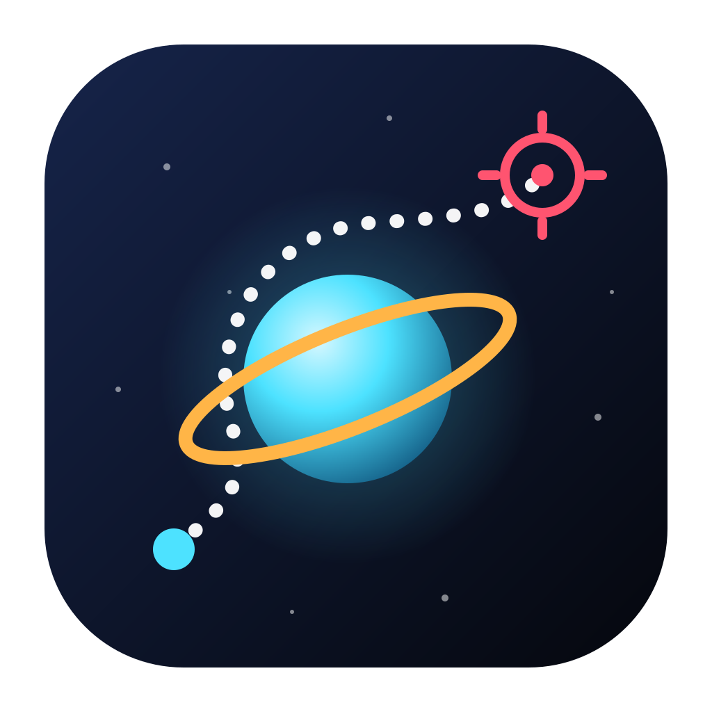
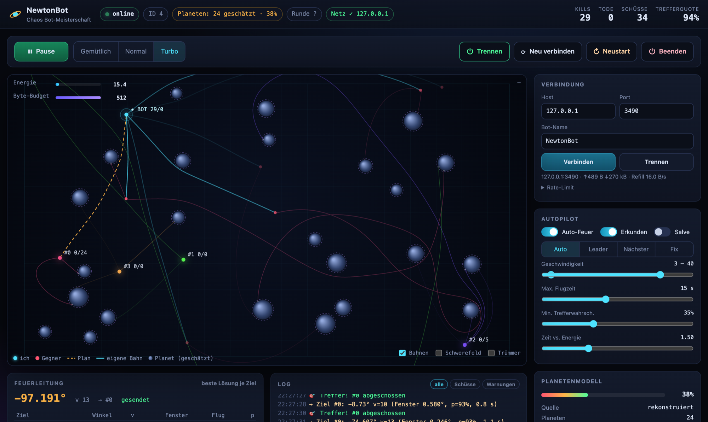
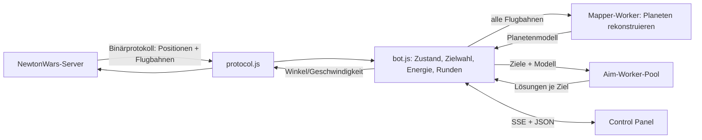

<p align="center">
  
</p>

<h1 align="center">NewtonBot</h1>

<p align="center">
  Aimbot mit Control Panel für <a href="https://github.com/Draradech/NewtonWars">NewtonWars</a>.<br>
  Findet die unsichtbaren Planeten aus den Flugbahnen heraus und trifft per exakter Physik-Simulation.
</p>

<p align="center">
  
</p>

---

**NewtonWars** ist ein Gravitations-Shooter: Jeder Spieler verbindet sich per Telnet, gibt Winkel und Geschwindigkeit ein,
und die Geschosse fliegen auf gekrümmten Bahnen um Planeten herum. NewtonBot spielt das automatisch. Entstanden ist er für
eine Bot-Meisterschaft, bei der der Server die Planetenpositionen *nicht* verrät.

- 🪐 **Planeten-Rekonstruktion:** aus den Flugbahnen aller Spieler, nach ~20–30 s auf Bruchteile eines Pixels genau
- 🎯 **Aimbot:** exakte Simulation, zielt auf die Mitte des Trefferfensters, Salven auf mehrere Ziele
- 🖥️ **Control Panel im Browser:** Karte, Start/Pause, Tempo-Modi, Live-Log
- 🍎 **Mac-App:** Doppelklick, und das Netzwerk richtet sie bei Bedarf selbst ein
- 📦 **Keine Abhängigkeiten:** nur Node.js, läuft offline im Event-WLAN

Live beim Event: **236 Kills, 5 Tode, 97 % Trefferquote** in einer 5-Minuten-Runde.

## Installation (Mac)

1. **Node.js 18 oder neuer** installieren: [nodejs.org](https://nodejs.org/) oder `brew install node`
2. `NewtonBot-mac.zip` unter [Releases](../../releases/latest) laden, entpacken und `NewtonBot.app` in den Programme-Ordner ziehen
3. Beim ersten Öffnen meldet macOS, dass die App aus dem Internet stammt und nicht notariell beglaubigt ist. Dann unter
   **Systemeinstellungen → Datenschutz & Sicherheit → „Dennoch öffnen“** freigeben, oder im Terminal:
   ```bash
   xattr -dr com.apple.quarantine /Applications/NewtonBot.app
   ```

## Benutzung

1. Mit dem WLAN des Spiels verbinden (z.B. „NewtonWars“)
2. **NewtonBot** öffnen. Das Panel geht im Browser auf (http://127.0.0.1:8090), und der Bot verbindet sich von selbst.
3. Fertig. Gesteuert wird alles über die Leiste oben:

| | |
|---|---|
| **Start / Pause** | Auto-Feuer an/aus (die Verbindung bleibt) |
| **Gemütlich · Normal · Turbo** | höchstens 1 Schuss alle 6 s · alle 2 s · so schnell wie möglich |
| **Verbinden / Trennen** | Spielverbindung |
| **Neu verbinden** | Verbindung neu aufbauen (der Server sperrt die IP danach ~10 s) |
| **Neustart** | Bot-Programm neu starten (Planeten werden in ~20 s neu gelernt) |
| **Beenden** | Bot komplett beenden |

Öffnet man die App erneut, während der Bot läuft, geht einfach das Panel wieder auf.

**Karte:** Klick auf einen Spieler macht ihn zum festen Ziel, Shift+Klick übernimmt einen Winkel für manuelle Schüsse.
In der Seitenleiste gibt es Zielmodus (Auto, Leader, Nächster, Fix), Geschwindigkeitsbereich, max. Flugzeit,
Mindest-Trefferwahrscheinlichkeit, den Zustand des Planetenmodells und einen manuellen Schuss.

### Netzwerk

Manche Event-WLANs vergeben keine Adresse per DHCP. Der Mac hängt dann auf `169.254.x.x`, und der Spielserver ist nicht erreichbar.
NewtonBot erkennt das und fragt per macOS-Dialog nach deinem Passwort, um dem WLAN eine **feste Adresse ohne Router**
zu geben (Standard `192.168.8.177`). Das Internet läuft dabei über ein anderes Interface weiter, z.B. USB-Tethering.
Ein kleiner Wächter hält die Adresse fest, solange der Bot läuft, und stellt beim Beenden wieder DHCP ein.
Den Status zeigt das Panel oben („Netz ✓“ bzw. ein Hinweisbanner mit Knopf).

Einstellungen liegen in `~/Library/Application Support/NewtonBot/config.json`, z.B.:

```json
{ "name": "MeinBot", "host": "192.168.8.8", "port": 3490, "staticIp": "192.168.8.177", "autoNetwork": true }
```

Das Log steht in `~/Library/Logs/NewtonBot/newtonbot.log`.

## Aus dem Quellcode

```bash
git clone https://github.com/Savo2610/newton-bot.git && cd newton-bot
npm start -- --connect          # Bot + Panel (http://127.0.0.1:8090)
npm run app:install             # NewtonBot.app bauen und nach ~/Applications kopieren
npm run app:zip                 # dist/NewtonBot-mac.zip fürs Release
```

Weitere Startparameter: `--host=… --port=… --name=… --http=8090 --config=pfad.json`.
Läuft auch unter Linux/Windows mit `npm start`, nur die automatische Netzwerk-Einrichtung ist macOS-spezifisch.

## Wie es funktioniert



**Woher die Daten kommen.** Per Telnet sieht man nur einen Prompt. Der Server hat aber einen kaum bekannten Bot-Modus:
`b 9` schaltet auf ein Binärprotokoll mit eigener ID, allen Spielerpositionen, dem Start jedes Schusses und der
**kompletten Flugbahn jedes Schusses aller Spieler** (ein Punkt pro Frame). Planeten sendet der Server nur mit `sendplanets 1`.

**Physik** (aus `simulation.c`, exakt nachgebaut in `src/physics.js`):
- Gravitation `a = Σ m·(p−x)/|p−x|³`
- Planeten mit `r ∈ [20, 40]` und `m = r³/10`
- Velocity-Verlet mit 25 Substeps pro Frame
- Spielerradius 4, Geschwindigkeit ≤ 50; ein Schuss kostet `v` Energie, +2/s
- Spieler bewegen sich nur beim Respawn, deshalb lohnt sich exaktes Vorausberechnen.

**Planeten-Rekonstruktion** (`src/mapper.js`): Die zweite Differenz der Bahnpunkte `x[i+1] − 2x[i] + x[i−1]` ist exakt das
Integral der Beschleunigung mit Dreieckskern über einen Frame. Jede Flugbahn liefert so Hunderte Messungen des Schwerefelds,
und das Feld ist linear in den Massen. Daraus entsteht das Modell so:
- **Kandidaten:** NNLS auf einem 22-px-Gitter.
- **Verfeinern:** Levenberg-Marquardt passt (x, y, m, r) aller Planeten gemeinsam an.
- **Zusätzliche Bedingungen:**
  - Wo ein Geschoss geflogen ist, kann kein Planet sein.
  - Einschläge liegen auf Planetenoberflächen.
  - Prior `m = r³/10`.
- **Aufräumen:** verschmolzene Planetenpaare werden erkannt und wieder getrennt.
- **Qualitätskontrolle:** Beobachtete Bahnen werden mit dem Modell nachsimuliert.

Gegen den Original-Server (`sendplanets 1` als Wahrheit): 24/24 Planeten, Median-Fehler 0,03 px.

**Zielen** (`src/aim.js`): Pro Geschwindigkeit läuft ein Winkel-Sweep. Lokale Minima des Abstands zum Ziel werden mit dem
Goldenen Schnitt verfeinert, und die Ränder des Trefferfensters per Bisektion bestimmt; gezielt wird auf die Mitte des Fensters.
Die Trefferwahrscheinlichkeit kommt aus der Fensterbreite und einem Ensemble gestörter Planetenmodelle (Kovarianz aus dem Fit).
Bahnen, die dem Bot selbst zu nahe kommen, fliegen raus. Der Solver läuft parallel auf mehreren Kernen, Lösungen werden
pro Ziel gecacht und direkt vor dem Feuern gegen das neueste Modell geprüft.

**Zielwahl:** Score = Trefferwahrscheinlichkeit × Wert / (Energiekosten + Flugzeit). Der Leader ist mehr wert (Extrapunkte),
ebenso wer uns gerade abgeschossen hat. Mit vollem Tank sind schnelle Schüsse praktisch gratis.

**Server-Regeln, die der Bot einhält** (aus `network.c`):

| Regel | Umgang |
|---|---|
| Rate-Limit: 512-Byte-Bucket, +1 Byte alle 3 Frames (~20 B/s), sonst Kick | eigener Token-Bucket (16 B/s), passt sich bei vermutetem Kick an |
| Nur **eine** Verbindung pro IP | nicht parallel per Telnet vom selben Rechner spielen |
| Jeder Verbindungsversuch sperrt die IP ~10 s | Reconnect frühestens nach 12 s, Server-Check nur per ping |
| 5 min ohne Eingabe = Disconnect | Energie-Abfrage hält die Verbindung aktiv |
| Runde 300 s + 20 s Pause, dann neue Planeten | Rundenwechsel und Pause werden erkannt, das Modell neu gelernt |

**Robustheit:**
- Kommen 15 s lang keine Daten, wird die Verbindung neu aufgebaut.
- Ein Supervisor startet den Prozess bei Absturz oder hängendem Netz neu.
- Der Mac bleibt per `caffeinate` wach, solange der Bot läuft.

### Projektstruktur

| Datei | Aufgabe |
|---|---|
| `src/physics.js` | Spielphysik, Schuss-Simulation |
| `src/mapper.js` | Planeten-Rekonstruktion |
| `src/aim.js` | Aim-Solver |
| `src/protocol.js` | Telnet-Handshake, Binärprotokoll, Rate-Limit, Reconnect |
| `src/bot.js` | Spielzustand, Zielwahl, Energie, Runden, Lösungs-Cache |
| `src/netcheck.js` | Netzwerk-Status und automatische IP-Einrichtung (macOS) |
| `src/server.js` · `src/supervisor.js` · `src/worker.js` | Panel-Server, Auto-Neustart, Worker-Threads |
| `public/` | Control Panel (HTML/CSS/JS, ohne externe Abhängigkeiten) |
| `scripts/` | App-Bundle bauen, App-Starter |
| `tools/` | Offline-Tests, Zufalls-Gegner für lokale Tests |

### Lokal testen

```bash
# Original-Server bauen (macOS): https://github.com/Draradech/NewtonWars → sh build-mac.sh
./nw fullscreen 0 sendplanets 1 roundtime 120
node tools/dummies.js 127.0.0.1 4 3500                                # 4 Zufalls-Schützen
echo '{"useServerPlanets": false}' > /tmp/nwtest.json                # Server-Planeten nur als Referenz
node src/server.js --host=<LAN-IP> --http=8091 --config=/tmp/nwtest.json --connect
```

Über die LAN-IP verbinden, sonst greift das Rate-Limit nicht (localhost ist ausgenommen). Offline-Tests:
`npm run test:mapper`, `npm run test:aim`.

## Credits

- **[NewtonWars](https://github.com/Draradech/NewtonWars)** von Manuel Kasten ([@Draradech](https://github.com/Draradech)), MIT-Lizenz.
  Spiel, Physik und Bot-Protokoll stammen von dort. NewtonBot ist ein eigenständiger Client, der sich an `simulation.c` und `network.c` orientiert.
- NewtonWars ist inspiriert von [Gravitational Combat](https://web.archive.org/web/20041128233753/http://home.cs.tum.edu/~jain/software/gravcombat.php).

## Lizenz

[MIT](LICENSE)
